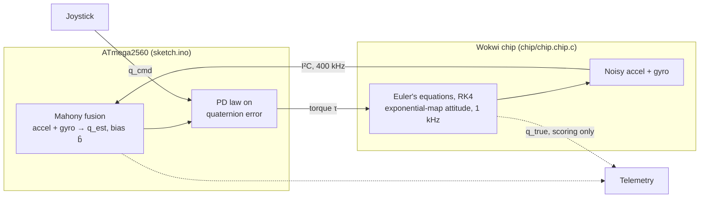
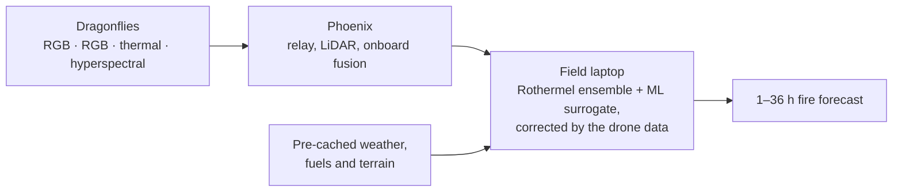

# Wildfire VTOL

A small fleet of VTOL drones that maps a wildfire from the air and feeds a fire-spread forecast running on a laptop in the field, 1 to 36 hours ahead. **Phoenix**, a tiltrotor mothership, carries LiDAR and relays data; four **Dragonfly** tailsitters carry RGB, thermal and hyperspectral cameras. It is developed in simulation.

> **Builds on** [aerospace-surrogate](https://github.com/raahimnawaz/aerospace-surrogate) for the wing model and [wildfire](https://github.com/raahimnawaz/wildfire) for the fire forecast, both planned for later stages (see the [roadmap](docs/roadmap.md)).

What exists today is stage 0, the attitude core every aircraft will fly on: quaternion attitude estimation and control on an ATmega2560 with no floating-point unit, against a rigid-body plant simulated in a custom Wokwi chip. The microcontroller never sees the true attitude: it estimates it from a noisy accelerometer and gyroscope and closes a PD loop on quaternion error.

## Attitude core results

Measured in software-in-the-loop: the real firmware and plant on a simulated clock and I²C bus, plus a cycle-accurate AVR simulator.

| | Result |
|---|---|
| Control rate | 22.9 Hz → **179 Hz**, worst loop period 45.3 ms → 6.9 ms, after fixing a bus-speed reset and a blocking display call |
| Unwinding, from 359° | Without the fix the body travels 372°; with it, **4.5°** |
| Gyro bias | Roll and pitch recovered within 0.0004 rad/s in about 3 s. Yaw is not: without a magnetometer the body turns −69° in 30 s while the estimate says it hasn't moved |
| A dropped IMU read | Estimate 11.8° off truth before the fix, 0.2° after |

Bus and ADC timing in the harness are modelled; CPU time is measured. None of this has been re-run in Wokwi or on a real board yet.

## How it works



```
q_err = q_est⁻¹ ⊗ q_cmd
τ     = Kp · sign(q_err.w) · q_err.vec  −  Kd · (ω_gyro − b̂)
```

- **Estimation.** A Mahony complementary filter fuses the accelerometer's gravity reference with gyro integration, and its integral term estimates the gyro bias `b̂`.
- **Unwinding fix.** `q` and `−q` are the same rotation, so `sign(q_err.w)` makes the controller take the short way round.
- **Clean derivative term.** It uses the raw gyro minus `b̂`, not the filter's corrected rate, which would feed accelerometer noise into the torque.
- **Gains.** `ωn = 3.0 rad/s` and `ζ = 0.7` on all three axes. The front-panel knob scales both gains together, which sweeps damping from 0.22 to 1.21.

Conventions, gain design and timing are in [docs/attitude-core.md](docs/attitude-core.md).

## Limitations

- **Yaw is unobservable** without a magnetometer. Stage 1 adds one.
- **The accelerometer measures gravity only.** No linear acceleration is modelled, so a manoeuvring vehicle is never exercised.
- **The plant's gyro has no bias,** so a Wokwi run gives the bias estimator nothing to find.
- **`dt` is unclamped.** A stalled bus feeds one large step into the integrator.

## Where this is going



| Stage | What |
|---|---|
| 0 | Attitude core on an FPU-less AVR (done) |
| 1 | Plant models for Phoenix and a Dragonfly, with wing aerodynamics through stall |
| 2 | Flight controller on an FPU microcontroller, hardware in the loop |
| 3 | All five aircraft in PX4 SITL, with fault injection |
| 4 | Photorealistic California fire scenes and sensors in Isaac Sim |
| 5 | The field forecast, fed live from the simulated fleet |
| 6 | Hardware, optional |

Flying near an active wildfire is prohibited in the US unless you are part of the response, so the project is simulation first and may stay there. The airframe choices, the sensor-to-forecast mapping, the simulation stack and each stage's goal are in [docs/roadmap.md](docs/roadmap.md).

## Running it

Open the project in [Wokwi](https://wokwi.com); `diagram.json` and `sketch.ino` must stay in the repository root. To build the firmware locally:

```bash
pio run
```

Telemetry streams over serial at 115200 baud, 9 columns at 30 Hz:

```
q_est.w, q_est.x, q_est.y, q_est.z, q_true.w, q_true.x, q_true.y, q_true.z, max_dt_us
```

Attitude error in degrees is `2·acos(|⟨q_est, q_true⟩|)`, computed on the host. `q_true` is read only after the torque command has gone out, so the estimator never sees it.

## Layout

```
sketch.ino        firmware: fusion, control law, OLED, telemetry
chip/             simulated plant: rigid-body dynamics and IMU
docs/             attitude-core notes and the fleet roadmap
diagram.json      Wokwi wiring
libraries.txt     Wokwi library manifest
platformio.ini    local AVR build
```

## Archive

Earlier results and tooling live in tags:

| Tag | Holds | Restore with |
|---|---|---|
| [`archive-v2`](https://github.com/raahimnawaz/wildfire-vtol/tree/archive-v2) | The test harness and cycle benchmark behind every number above, CI, the naive control law, and the full write-up of each result | `git checkout archive-v2 -- test .github results README.md` |
| [`archive-v1`](https://github.com/raahimnawaz/wildfire-vtol/tree/archive-v1) | The recorded 181° Wokwi runs, the original design blueprint, and the v1 STM32WBA55 schematic with its review (eight netlist defects; don't fabricate it as drawn) | `git checkout archive-v1 -- docs hardware results` |
