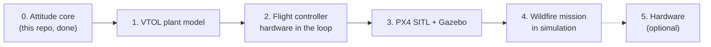
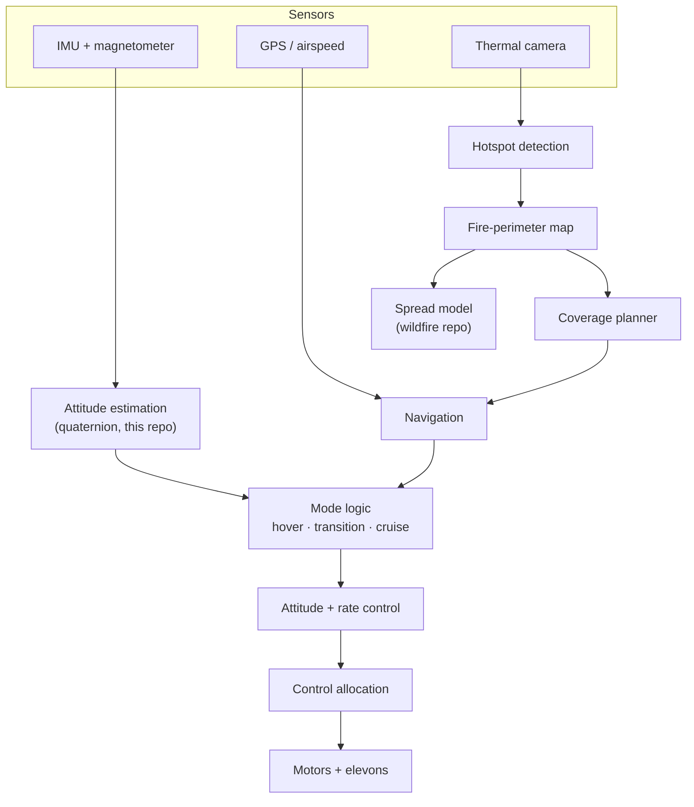

# Roadmap: a wildfire-mapping VTOL

The goal is a drone that takes off and lands vertically, then flies like a plane to cover large areas of fire country, finding hotspots with a thermal camera and mapping the fire's edge. Wing-borne cruise is the reason for a VTOL instead of a quadrotor: it gives several times the range and endurance, which is what mapping a fire perimeter needs.

Development is simulation first, and the project may stay there. In the US, flying near an active wildfire is prohibited unless you are part of the response, and a simulator can still test every piece.

## Choosing the airframe

| Configuration | Examples | For | Against |
|---|---|---|---|
| **Tailsitter** | Bell APT 70, Shield AI V-BAT | Mechanically simplest: no tilting parts. The whole aircraft pitches 90° between hover and cruise, which is exactly where Euler angles break and quaternions don't | Transition is the hardest control problem; hover is sensitive to wind on the wing |
| **Tiltrotor** | Bell V-280 Valor | Efficient in both hover and cruise; the closest to the Bell look | Tilt mechanisms add weight, servos and failure modes; the transition corridor is narrow |
| **Lift + cruise (quadplane)** | Many small military and survey drones | Easiest to fly and the most forgiving; hover and cruise use separate motors | Carries dead weight in each phase; the least interesting control problem |

**Leaning towards a tailsitter.** It is the one where this repo's quaternion attitude core is essential rather than optional, and PX4 supports all three configurations, so the choice can still change after stage 1.

## Stages

| Stage | What | Where it runs | Done when |
|---|---|---|---|
| 0 | Quaternion attitude estimation and control on an FPU-less AVR | Wokwi + software in the loop | Done: 179 Hz loop, unwinding fixed, bias estimated |
| 1 | VTOL plant: propeller thrust and torque, wing lift and drag through stall (from [aerospace-surrogate](https://github.com/raahimnawaz/aerospace-surrogate)), elevons, wind, and a magnetometer so yaw becomes observable | Simulation | Hover, transition and cruise all reproduce expected trim |
| 2 | Move the controller to a microcontroller with an FPU, add mode logic (hover, transition, cruise) and a rate loop at 1 kHz or faster | A real board on a desk, against the stage-1 plant | Stable transition in both directions, with the board in the loop |
| 3 | Full flight in PX4 SITL with Gazebo, with this attitude controller in place of PX4's | Simulation | A complete mission: take off, transition, cruise, return, land |
| 4 | Wildfire scene: a thermal camera, hotspot detection, a fire-perimeter map fed to the spread model from [wildfire](https://github.com/raahimnawaz/wildfire), and coverage planning | Simulation | Perimeter error measured against the simulated fire |
| 5 | A small foam airframe: tethered hover, then legal open-field flights. Real fire only with a land manager's permission or a fire-agency partnership | Hardware | Optional |

## Target architecture

