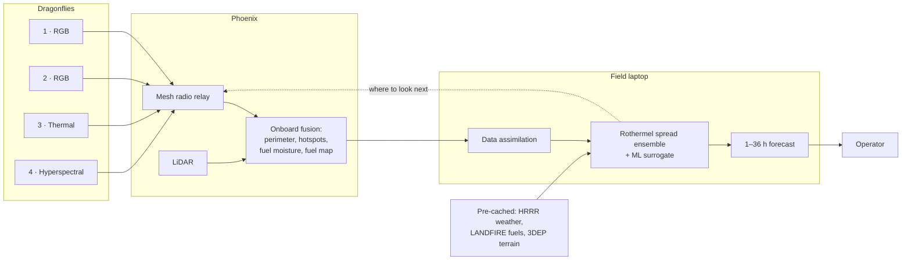
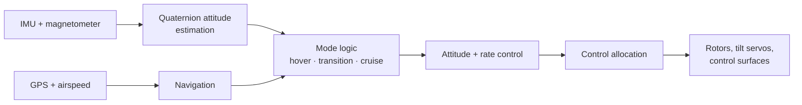
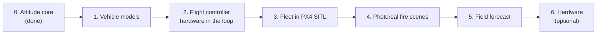

# Roadmap

A small fleet that maps a wildfire from the air and feeds a fire-spread forecast running on a laptop in the field, 1 to 36 hours ahead. Development is simulation first and may stay there: in the US, flying near an active wildfire is prohibited unless you are part of the response.

## The fleet

| Aircraft | Airframe | Payload | Job |
|---|---|---|---|
| **Phoenix** (mothership) | Tiltrotor, Bell V-280 style | LiDAR, mesh radio, onboard computer | Holds station above the smoke, relays the Dragonflies' data, updates the fuel map, and fuses observations before sending them down |
| **Dragonfly 1** | Small tailsitter | RGB camera | Live view, and 3D terrain and vegetation from photos |
| **Dragonfly 2** | Small tailsitter | RGB camera | Same, from a second angle |
| **Dragonfly 3** | Small tailsitter | Thermal camera | Fire perimeter and hotspots, through smoke |
| **Dragonfly 4** | Small tailsitter | Hyperspectral camera | The active flame front, and the moisture and type of the fuel ahead of it |

**Why these airframes.** Wing-borne cruise gives the range and endurance a perimeter survey needs, which rules out plain quadrotors.
- **Phoenix is a tiltrotor.** It is efficient in both hover and cruise and has room for payload. Its hard part is control: the rotors tilt through the transition and the aerodynamics change with tilt angle. The tilt servos are modelled with real rate limits, lag and injected failures, so the simulation does not hide what makes tiltrotors difficult.
- **Dragonflies are tailsitters.** They are light, have no tilting parts and cruise efficiently. They hover only at launch and landing, away from the fire, so a tailsitter's sensitivity to gusts in hover matters less. Each one pitches 90° between hover and cruise, exactly where Euler angles fail, which makes this repo's quaternion attitude core essential.

**Known risk.** Thermal is the most important sensor and only one aircraft carries it. A second thermal camera on one of the RGB Dragonflies would remove that single point of failure.

## System

Each aircraft runs the same flight stack, with this repo's attitude core at its centre:

## What each sensor gives the forecast

The field forecast is built on the Rothermel surface-fire spread equations. Every input has a source, and the drones correct the ones that matter most.

| Input | Source | What the fleet adds |
|---|---|---|
| Fuel model | LANDFIRE (40 standard fuel models) | Hyperspectral corrects the fuel type ahead of the fire |
| Live fuel moisture | Hyperspectral (Dragonfly 4) | Measured directly, instead of estimated from season |
| Dead fuel moisture | Weather, through a standard fuel-moisture model | |
| Wind | HRRR forecast, adjusted for terrain with WindNinja | |
| Slope | USGS 3DEP elevation | |
| Canopy structure, for crown fire | LANDFIRE canopy layers and 3DEP LiDAR | Phoenix's LiDAR updates areas that changed since the survey |
| Perimeter and rate of spread | Thermal (Dragonfly 3) and the hyperspectral fire index | Used to correct the forecast every time new data arrives |

**Hyperspectral has two jobs.** Shortwave-infrared indices map active flames through smoke (a CO₂-band ratio around 2000 nm, and the Hyperspectral Fire Detection Index). Visible and near-infrared bands measure the fuel that has not burned yet. Potassium emission near 766–770 nm is a specific signature of flaming, but earlier airborne studies found it unreliable through smoke, so it is a stretch goal.

**Forecast models.** WRF-SFIRE couples a full weather model to fire spread and needs a cluster, so it runs beforehand to generate training fires. In the field, an ensemble of a fast Rothermel-based spread model (such as ELMFIRE) is corrected by the drone data, alongside an ML surrogate trained on those runs. The [wildfire](https://github.com/raahimnawaz/wildfire) repo's ignition and spread models extend to take these inputs.

**Targets.** Perimeter error in metres at 6, 12 and 24 hours, measured against simulated fires first, then historical California fires.

## Simulation

| Layer | Tool | Runs on |
|---|---|---|
| Flight control and vehicle dynamics | Own plant models, then PX4 SITL with Gazebo, all five aircraft at once | The Macs |
| Wing aerodynamics through stall | Lifting-line solver and surrogate from [aerospace-surrogate](https://github.com/raahimnawaz/aerospace-surrogate), applied as forces | Any |
| Photorealistic scenes and sensors | NVIDIA Isaac Sim (Omniverse): California terrain from 3DEP, LANDFIRE vegetation, fire and smoke, RGB cameras and LiDAR | An NVIDIA RTX GPU with 16 GB, on a PC or rented in the cloud |
| Thermal and hyperspectral cameras | Rendered from surface temperatures and spectral libraries; no built-in sensor exists | Isaac Sim |
| Faults | Stuck or slow tilt servos, motor loss, radio dropouts, GPS loss | All layers |

## Stages

| Stage | What | Done when |
|---|---|---|
| 0 | Quaternion attitude estimation and control on an FPU-less AVR | Done: 179 Hz loop, unwinding fixed, gyro bias estimated |
| 1 | Plant models for Phoenix and a Dragonfly: rotors, wing lift and drag through stall, tilt-servo dynamics, control surfaces, wind and gusts, a magnetometer so yaw is observable | Hover, transition and cruise trim for both airframes |
| 2 | The controller on a microcontroller with an FPU, with mode logic and a rate loop at 1 kHz or faster. Firmware in Rust (Embassy), C++ where PX4 requires it | Stable transitions both ways, with the board in the loop |
| 3 | All five aircraft in PX4 SITL with this attitude controller, mesh radio and fault injection | A full survey mission: launch, transition, cover the perimeter, relay, return, land; and the mission survives a stuck tilt servo |
| 4 | Isaac Sim scenes of real California terrain with fire and smoke, and all five sensors rendered | Sensor output that the detection code cannot tell from the textbook signatures |
| 5 | The field forecast: assimilation, spread ensemble and surrogate on a laptop, fed live from the simulated fleet, working offline | Perimeter error measured at 6, 12 and 24 hours |
| 6 | A small foam airframe: tethered hover, then legal open-field flights. Real fire only with a land manager's permission or a fire-agency partnership | Optional |

## References

- Fuels and canopy layers: [LANDFIRE](https://landfire.gov)
- Terrain and LiDAR: [USGS 3D Elevation Program](https://www.usgs.gov/3d-elevation-program)
- Weather: [HRRR](https://rapidrefresh.noaa.gov/hrrr/); terrain winds: [WindNinja](https://github.com/firelab/windninja)
- Coupled fire-weather model: [WRF-SFIRE](https://github.com/openwfm/WRF-SFIRE); fast spread model: [ELMFIRE](https://github.com/lautenberger/elmfire)
- Hyperspectral fire detection: [Dennison et al. 2006](https://content.csbs.utah.edu/~pdennison/reprints/denn/2006_Dennison_IJRS.pdf), [Dennison & Roberts 2009](https://content.csbs.utah.edu/~pdennison/reprints/denn/2009_Dennison_and_Roberts_RSE.pdf), [Waigl et al. 2019](https://content.csbs.utah.edu/~pdennison/reprints/denn/2019_Waigl_etal_IJ_Appl_Earth_Obs_Geoinfo.pdf)
- Simulator: [Isaac Sim requirements](https://docs.isaacsim.omniverse.nvidia.com/5.1.0/installation/requirements.html)
